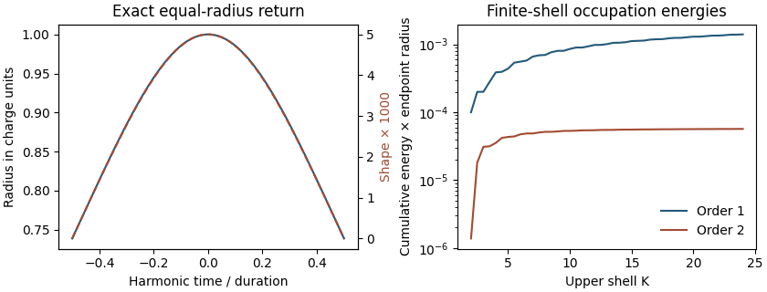

# 第5節　励起量の定量的な上下界

全モードにわたる評価の定数は実際に計算できる。表2では直接積分したモードと解析的に評価した尾部を分けて示す。混合する最低ブロック $`k=2,M=1`$ の1コピーだけでも、遷移確率は一次で $`7.8066279\ldots\times10^{-7}`$ 、二次で $`1.0775406\ldots\times10^{-8}`$ である。したがって、正であると述べた有限の占有数やエネルギーには、外挿を行う前から非零の寄与がある。一方、丸い解では Pauli 行列が定める軸が時間に依存しないので、どのモードでも混合は零である。

**表2.** 各区間は外向きに丸めて表示した。 $`S_m`$ は粒子数であり、正孔だけを数えた場合も同じ値になる。 $`\Delta E_m`$ は正負両方の寄与を含む。

| 量 | $`k\le24`$ の保証区間 | $`k>24`$ の上界 | 全モード |
|---|---|---|---|
| $`10^{5}S_1`$ | $`[6.11898256,6.11898265]`$ | $`1.941698`$ | $`[6.11898,8.06069]`$ |
| $`10^{6}S_2`$ | $`[4.05596267,4.05596272]`$ | $`0.369712`$ | $`[4.05596,4.42568]`$ |
| $`10^{5}q_e\Delta E_2`$ | $`[5.6837493,5.6837498]`$ | $`5.32385`$ | $`[5.68374,11.00760]`$ |

直接積分する有限範囲は、混合する殻に属する正の磁気量子数551個からなる。端点射影を適用する前に、元の固定スピン標構で微分方程式を積分する。こうすればトレースの位相に由来する誤差を別に扱う必要がなく、局所打切り誤差の蓄積をユニタリ性によって制御できる。[付録A](DPPUv8-paper12_appA.md)で Taylor 評価と尾部の角運動量和を示す。係数とギャップはセル全体にわたって囲い込む。これには、比を固定した少数の半直線だけを調べると取りこぼし得る極限 $`\mu\to1`$ も含まれる。

全モードの二つの保証区間から、二次の総数は一次の総数の $`5.03\%`$ から $`7.24\%`$ の間にある。これは二つの粒子定義を、指定した履歴の全体について比較した結果である。次数をもう一段上げると、有限な占有数が増えることもある。[付録B](DPPUv8-paper12_appB.md)には、最低殻が支配的な三次との比較を示す。図1は同じデータから、重みと打切りの影響を示したものである。一次の曲線の有限部分だけでは、紫外尾部の対数発散までは判定できない。

**図1.** 左は厳密な往復解の電荷で規格化した半径（実線）と形状（破線、右軸）。右は図示した球面の各殻までの、正の励起エネルギーの累積値である。各項には保証された遷移確率の区間の中点を用いた。

[英語原文](LaTeX/sections/sec05.tex)

[← 第4節](DPPUv8-paper12_sec04.md)　[目次](README_ja.md)　[第6節 →](DPPUv8-paper12_sec06.md)
